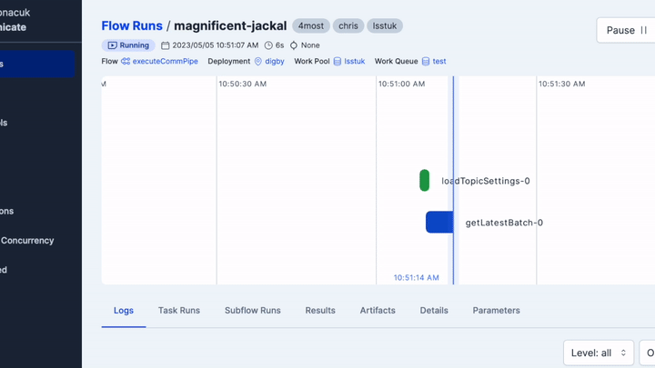

# tides-ingest

The TiDES ingest pipeline does four things:
- reads transient alerts that pass the TiDES selection functions on the Lasair broker (LSST now; ZTF and others later);
- merges detections of the same object from any survey into one TiDES object (`TiDES26abc`);
- keeps the objects' state and full provenance in PostgreSQL;
- keeps the **4MOST** target queue in step: it creates targets, switches them off when they stop being detected, and reports brightness milestones.

A separate flow matches host galaxies and queues them once the transient has faded.



**→ The complete guide is [USER_GUIDE.md](USER_GUIDE.md).** It covers:
- how it works;
- configuration;
- deployment;
- runbooks;
- provenance queries;
- known limitations.

## In one minute

```
Lasair (TiDES SQL filter) ──Kafka──▶ tides_flows/tides_controller.py  (Prefect flow, hourly)
    per survey: read → validate → match within 1″ / create → events → commit DB → commit Kafka offsets
    then: deactivate after N observing nights without a detection → 4MOST outbox (create / on-off / milestones)
db_4MOST_tasks/sync_ostd.py                      copies 4MOST's OSTD ids back (read-only to 4MOST)
host_tools/tides_host_matching/ (submodule)      Sherlock host galaxies → host queue (4MOST submission currently off)
```

## Quick start (development)

```bash
git clone --recurse-submodules https://github.com/TiDES-4MOST/tides-ingest.git && cd tides-ingest
conda create -n tides python=3.12 -y && conda activate tides && pip install -r requirements.txt
cp .env.example .env                     # fill in; keep TIDES_ENV=development, FOURMOST_MODE=off
# create a database with the q3c extension, then from database_setup/:  ./setupDB.sh && ./migrate.sh
python testing/test_4most_downtime.py    # integration test on your *test* database (never contacts 4MOST)
```

See [USER_GUIDE.md §5](USER_GUIDE.md#5-quick-start) for the full steps.

## Safety

- The 4MOST endpoint is the **production** system, and survey id 15 is shared with another programme.
- Writes to 4MOST happen only with `FOURMOST_MODE=live` **and** `TIDES_ENV=production`.
- Development and tests use `off`, `dry_run`, or the in-memory fake.
- Never use the production Kafka group id on a development machine.
- Full rules: [USER_GUIDE.md §14](USER_GUIDE.md#14-safety-rules).

## Other documents

| Document | Contents |
|---|---|
| [USER_GUIDE.md](USER_GUIDE.md) | everything (start here) |
| [testing/README.md](testing/README.md) | how to run and extend the tests |
| [USER_GUIDE_SUBMIT_TRANSIENTS.md](USER_GUIDE_SUBMIT_TRANSIENTS.md) | the 4MOST client (`submit_transients.py`) as a Python library |
| [USER_GUIDE_HOST_MATCHING.md](USER_GUIDE_HOST_MATCHING.md) | the host-galaxy flow (read with USER_GUIDE.md §9 and §15) |
| [qmost_db_utils/README.md](qmost_db_utils/README.md) | admin utilities (write actions currently disabled) |
